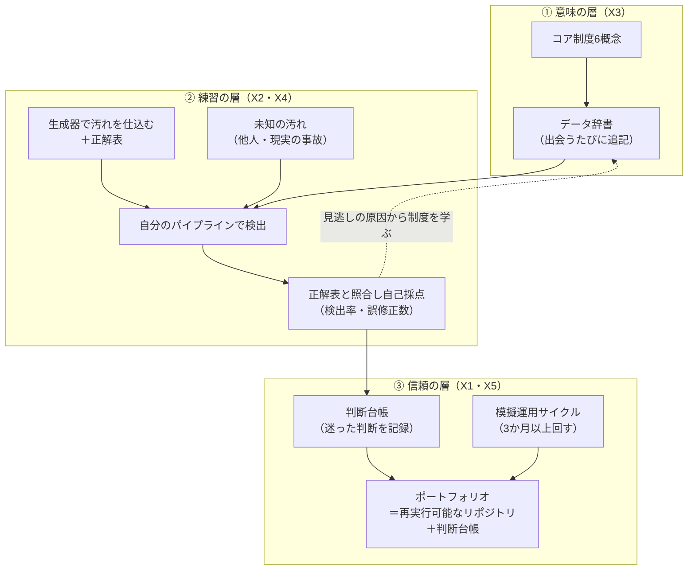

# 実務未経験からプロの人事データアナリストへ
## ― ハンズオン型 学習ロードマップ & トレーニングプログラム ―

> 本書は、5人の専門家エージェントによる3ラウンドの議論（ドリームチーム・ディスカッション）を経て設計したトレーニングプログラムです。
> 前半で「なぜこの設計なのか」の議論を、後半（[第2部](#第2部トレーニングプログラム本編)）で、そのまま実行できるステップバイステップの手順を示します。
>
> **前提**: Python（pandas）を主に使う／人事実務の経験はない／本リポジトリを教材にする
> **想定ペース**: 週10時間 × 約24週（6か月）。ペースが違う場合は「週」を「ブロック」と読み替えてください。

---

# 第1部：ドリームチーム・ディスカッション

## 🎯 アサインされた5名のエージェント

| # | エージェント | 専門領域 | 担当視座 |
|---|---|---|---|
| X1 | **熟練人事データアナリスト**（実務者） | 人事データの集計・突合・経営報告を15年 | プロは実務で何をしているのか |
| X2 | **学習科学者**（設計者） | 熟達化研究・意図的練習・フィードバック設計 | 未経験者はどうすれば最短で熟達するか |
| X3 | **人事制度・労務の専門家**（哲学者） | 雇用契約・発令・社会保険・労働時間制度 | データの「意味」はどこから来るのか |
| X4 | **データエンジニア**（批評者） | パイプライン設計・テスト・再現性 | 成果物は信頼に足る作りか |
| X5 | **採用側の人事部長**（測定者） | 人事データ担当者の採用と育成 | 何ができれば「プロ」と認め、任せるのか |

---

## ROUND 1 — 独立深層分析

### 🧑‍💼 X1 熟練人事データアナリスト
**「プロの価値は分析の巧さではなく、『その数字は正しいのか』に答えられることにある」**

> [!note] コア主張
> 未経験者は「分析スキル（可視化・統計・機械学習）」を学ぼうとするが、現場で最初に、そして最も頻繁に問われるのは **「この在籍人数、本当に合ってる？」** という問いだ。プロとアマの差は、この問いに **根拠付きで即答できるかどうか** に尽きる。

実務の時間配分を正直に言えば、分析そのものは2割、残りの8割は「数字を信じてよい状態にする」作業――母集団の定義、基準日の確認、システム間の突合、差異の説明――だ。経営会議で人員数が部署ごとに食い違えば、どれほど美しいダッシュボードも一瞬で信用を失う。逆に、どんな質問にも「その数字は○月末時点、出向者を除く、Aシステム基準です。Bとの差異3名は入社日のタイミング差です」と答えられる人は、地味でも絶対に手放されない。

だから学習の中心に置くべきは **「定義して、数えて、突き合わせて、説明する」** の反復であり、機械学習ではない。

**未解明の問い:** 「数字が正しい」という感覚は、どれだけの回数の突合を経験すれば身につくのか。経験の **回数** が重要なのか、**種類** が重要なのか。

---

### 🧠 X2 学習科学者
**「未経験者に欠けているのは知識ではなく、『判断の事例ストック』と『答え合わせの手段』である」**

> [!note] コア主張
> 熟達とは、典型的な状況を大量に見て、瞬時に「これは前に見たあのパターンだ」と認識できるようになることだ。人事データ分析の独学が難しい最大の理由は、**練習問題に正解が付いていない** ことにある。実データには答えがなく、公開データセットは汚れ方がリアルでない。

意図的練習（deliberate practice）が成立する条件は3つある――①少し難しい課題、②**即時のフィードバック**、③反復。独学の人事データ学習では②が完全に欠けている。自分のクレンジングが正しかったのか、見逃しがあったのか、誰も教えてくれない。

ここに名前のついていない現象がある。私はこれを **「答えのない練習問題」問題** と呼びたい。答え合わせができない練習を何百時間続けても、間違った癖が強化されるだけだ。

解決の鍵は、**正解を知っている人間がデータを汚す** ことだ。学習者自身が「汚れを仕込んだデータ」と「仕込みの一覧（正解表）」を生成し、そのあと自分の検出パイプラインがどれだけ見つけられたかを **数値で自己採点** する。これで独学に②が生まれる。

**未解明の問い:** 自分で仕込んだ汚れを自分で見つけるのは「カンニング」にならないか。仕込む人と見つける人を分離する方法はあるか。

---

### ⚖️ X3 人事制度・労務の専門家
**「人事データの各列は、制度が落とした影である。制度を知らずにデータは読めない」**

> [!note] コア主張
> 「退職日」という列ひとつに、最終出勤日・最終在籍日・社会保険の資格喪失日（退職日の翌日）という複数の意味がある。「休職」が在籍に含まれるかどうかは、統計上の定義ではなく **就業規則と雇用契約** で決まる。データの意味は、データの中ではなく制度の中にある。

データ畑から来た人がつまずくのは、技術ではなくここだ。たとえば「育児休業中の社員を人員数に含めるか」「出向者は出向元と出向先のどちらで数えるか」「月の途中で入社した人は、その月の在籍者か」。どれも **正解は会社が決めるもの** であり、アナリストの仕事は「どの定義を採用したかを明示すること」と「定義が混ざっていないかを検知すること」だ。

もう一つ、未経験者が見落とす事実がある。人事データの値は、**発令という法的・事務的な行為によって生まれる**。「所属が変わった」のではなく「異動発令が出た」のだ。だから値には必ず「発令日（いつから有効か）」がある。発令を理解することが、人事データを理解することの中核になる。

**未解明の問い:** 人事制度を「網羅的に」学ぶ必要はあるのか。それとも、データに頻出する **少数の制度概念**（入社・退職・異動・休職・雇用区分・出向）だけで8割は足りるのか。

---

### 🛠 X4 データエンジニア
**「ポートフォリオとは作品集ではなく、他人が再実行して同じ結果を得られるリポジトリである」**

> [!note] コア主張
> 未経験者が作りがちなのは、Jupyter Notebook上で一度だけ動いた「分析の成果物」だ。しかし人事データの仕事は **毎月繰り返す** 仕事であり、価値は「一度うまくいったこと」ではなく「毎月同じ品質で回ること」にある。だから学習の成果物は、**再実行可能で、テストで守られたパイプライン** でなければならない。

このリポジトリの既存コードには、ちょうどよい教材になる欠陥がある。`Timestamp.today()` で未来日付を判定しているため、**実行する日によって結果が変わる**。`drop_duplicates(keep='first')` は、どちらのレコードが正しいかを判定しないまま一方を捨てる。これらは「動くけれど信頼できない」コードの典型であり、**それを自分で見つけて直せること** 自体が、実務能力の証明になる。

学習者には、最初から次の習慣を身につけさせたい。乱数の種（seed）を固定する、基準日を引数で受け取る、原本を書き換えない、変換ログを残す、既知の汚れパターンをテストにする。どれも難しくはないが、後付けは非常に難しい。

**未解明の問い:** 人事データアナリストにとって、エンジニアリングの品質はどこまで必要か。「コードが書けるアナリスト」と「人事が分かるエンジニア」の境界線はどこにあるのか。

---

### 👔 X5 採用側の人事部長
**「未経験者が越えるべき壁は『スキル不足』ではなく『個人データを任せてよいかという信頼の欠如』である」**

> [!note] コア主張
> 私が人事データ担当者を採用するとき、最初に見るのはPythonのスキルではない。**全社員の給与や評価が見える権限を、この人に渡して大丈夫か** だ。技術は入社後に伸ばせるが、データの扱いに対する慎重さや判断の誠実さは、後から教えるのが難しい。

未経験者の履歴書には「実務経験」の欄が空いている。それを埋めるのは資格ではなく、**「この人は、実務で起きる状況でこう判断した」という具体的な証拠** だ。具体的には次の3つ。

1. 難しいケース（同姓同名、再雇用、旧姓）に対して **どう判断し、なぜそう判断したか** の記録
2. 「自動で直さず、人に確認を回した」という **慎重さの痕跡**
3. 個人情報を扱う前提での **設計上の配慮**（実データを使わない、最小限の項目、ログに氏名を出さない）

面接で「このリポジトリで一番難しかった判断は何ですか」と聞いたとき、3分間よどみなく語れる人を、私は採用する。

**未解明の問い:** 「判断の誠実さ」は、実務経験のない段階でどうすれば **外から観察可能** になるのか。

---

## ROUND 2 — クロスバリデーション

### X3 → X1 への根本的批判
**「『数字が正しいか』の前に、『正しい』を誰が決めるのかが抜けている」**

> [!warning] 批判ポイント
> X1は「数字が正しいかに答えられること」をプロの条件にしたが、在籍人数の「正しさ」は母集団の定義に依存し、その定義は人事制度と経営の方針で決まる。定義を問わずに突合の反復だけを訓練すると、**「どの定義で正しいのか」を問えない、正確だが的外れなアナリスト** が育つ。訓練には「定義そのものを疑い、決める人に確認する」練習が含まれなければならない。

### X1 → X3 への根本的批判
**「制度の網羅学習は、手を動かさない言い訳になる」**

> [!warning] 批判ポイント
> X3の主張は正しいが、制度は無限に深い。社会保険・税・労働時間・就業規則を網羅してからデータに触ろうとすれば、未経験者は半年たっても1行もコードを書かない。実務では **制度はデータの中で出会ったときに学ぶ** ものだ。「網羅してから使う」ではなく「データで出会った制度をその場で調べ、辞書に追記する」順序でなければ続かない。

### X4 → X2 への根本的批判
**「自分で仕込んだ汚れは、現実の汚れより必ず素直である」**

> [!warning] 批判ポイント
> X2の「仕込み正解」方式は優れているが、構造的な限界がある。学習者が想像できる汚れしか仕込めないのだ。現実の汚れは **想像の外** から来る――Excelで開いた瞬間に `1-2` が `1月2日` に変わる、CSVの途中で文字コードが変わる、システム移行時の一括変換で全員の入社日が `2000-01-01` になる。自分の想像力の範囲で閉じた練習は、**想像の外への耐性** を育てない。

### X2 → X4 への根本的批判
**「再現可能性へのこだわりは、学習初期の試行錯誤を殺す」**

> [!warning] 批判ポイント
> X4は最初からテスト・seed固定・変換ログを求めるが、学習初期は「何を作ればよいか分からない」段階であり、そこで品質要件を課すと認知的な負荷が高すぎて手が止まる。熟達研究の知見では、**最初は荒く速く回し、構造が見えてから整える** ほうが学習効率は高い。品質は段階的に引き上げるべきだ。

### X5 → X4 への根本的批判
**「きれいなコードは、人事の判断力の証明にならない」**

> [!warning] 批判ポイント
> テストが通る美しいパイプラインは、エンジニアとしての評価にはなるが、人事データアナリストとしての評価にはならない。私が知りたいのは **「差異が出たとき、どちらを正としたか、なぜか」** だ。コードの品質だけを追うと、エンジニア職の応募者と区別のつかないポートフォリオになる。判断の記録こそが差別化要因である。

### X1 → X5 への根本的批判
**「信頼は記録からではなく、小さな実績の積み重ねからしか生まれない」**

> [!warning] 批判ポイント
> X5は「判断の記録」で信頼を示せると言うが、書類上の記録はいくらでも美しく書ける。現場の信頼は「この人に任せた小さな仕事が、毎回ちゃんと終わった」という **継続の実績** から生まれる。独学でもこれを模擬する必要がある――つまり **一度きりの課題ではなく、毎月の運用サイクルを何度も回した証拠** が要る。

---

### ⚡ Round 2 で浮かび上がった5つの根本的緊張

**緊張1：「定義を問う力」 vs 「手を動かす速さ」**
→ 制度と定義を理解しないと的外れになり、理解を待つと永遠に始まらない。学習の **順序** の問題。

**緊張2：「答え合わせできる人工の汚れ」 vs 「想像の外から来る現実の汚れ」**
→ フィードバックのためには正解が要るが、正解を知っている時点で練習は現実より易しくなる。**練習の真正性** の問題。

**緊張3：「再現可能な品質」 vs 「初期の試行錯誤」**
→ 品質要件を早く課すと手が止まり、遅く課すと悪い癖が固まる。**品質の導入時期** の問題。

**緊張4：「エンジニアリングの証明」 vs 「人事判断の証明」**
→ コードの品質と判断の品質は別物であり、どちらか片方だけでは「人事データアナリスト」にならない。**職業的アイデンティティ** の問題。

**緊張5：「書かれた判断記録」 vs 「積み重なった運用実績」**
→ 記録は偽れるが、実績は未経験者には作れない。**信頼の証拠** の問題。

---

## ROUND 3 — 統合と最終結論

### 緊張の統合

**緊張1の統合 ―「出会い駆動の制度学習」**
X1とX3の対立は、**制度辞書をデータと同時に育てる** ことで解消する。最初に学ぶ制度は、データに必ず現れる **6つのコア概念（入社・退職・異動・休職・雇用区分・出向）** に限定する（X3の問いへの答え）。それ以外は、データの中で出会ったときに調べ、自分の「データ辞書」に追記する。制度の網羅は目標ではなく、**辞書が育っていく結果** である。

**緊張2の統合 ―「二重の汚れ」**
X2とX4の対立は、汚れを2層に分けることで包摂する。
- **第1層：仕込みの汚れ（Planted Dirt）** ― 自分で仕込み、正解表で自己採点する。フィードバック用。
- **第2層：未知の汚れ（Unknown Dirt）** ― 自分では仕込まない汚れ。他人（またはClaude）に生成器へ **見ないで汚れを追加してもらう**、あるいは「Excelで開いて保存する」「文字コードを変える」といった **現実の事故を物理的に再現** する。

これでX2の問い（カンニングにならないか）にも答えられる。第2層は仕込む人と見つける人が分かれている。

**緊張3の統合 ―「品質のはしご」**
X2とX4の対立は、品質要件を段階ごとに1段ずつ引き上げることで解消する。最初は Notebookで荒く回してよい。ただし **最初から守るのは2つだけ**――「原本を書き換えない」「乱数の種を固定する」。この2つは後から取り戻せないからだ。テスト・ログ・CLI化は、構造が見えた段階で導入する。

**緊張4・5の統合 ―「判断台帳」と「模擬運用サイクル」**
X4・X5・X1の対立は、2つの仕組みを組み合わせることで包摂する。
- **判断台帳（Decision Ledger）**：迷った判断を1件1行で記録する（状況・選択肢・選んだもの・理由・確認先）。コードの品質ではなく **判断の品質** を外から観察可能にする（X5の問いへの答え）。
- **模擬運用サイクル（Simulated Month-End）**：生成器で「翌月のデータ」を作り（入社・退職・異動を進める）、同じパイプラインを **3か月分以上回す**。1か月目と3か月目の作業時間と未説明差異の件数を比較する。これが独学で作れる **継続の実績**（X1の批判への答え）になる。

X1の問い（回数か種類か）への答え：**種類は第1層・第2層の汚れで、回数は模擬運用サイクルで、それぞれ確保する。**

### 📐 統合フレームワーク：「仕込み正解・徒弟制（Planted-Truth Apprenticeship）」



**独自に生まれた概念**
| 概念 | 意味 |
|---|---|
| **「答えのない練習問題」問題** | 正解のない練習を繰り返すと、誤った癖が強化される現象 |
| **仕込み正解（Planted Truth）** | 汚れを仕込んだ本人が正解表を持ち、検出を数値で自己採点する方式 |
| **二重の汚れ（Planted Dirt / Unknown Dirt）** | 自己採点用の汚れと、想像の外への耐性を作る汚れを分ける考え方 |
| **品質のはしご** | 初日から守るのは「原本不変」「seed固定」の2つだけ、他は段階的に導入 |
| **判断台帳（Decision Ledger）** | 判断の品質を外から観察可能にする記録 |
| **模擬運用サイクル** | 合成データで月次運用を繰り返し、独学で「継続の実績」を作る方法 |

### 🔮 最終メタ結論

> [!quote] 議論の収束
> **未経験者がプロになる最短路は、知識を積むことではなく、答えを隠した汚いデータを自分で作り、それに対する自分の判断を記録し、その判断の正しさを測れる環境ごと毎月回し続けることである。**

## ✅ 議論品質の自己評価

| 評価項目 | 結果 |
|---|---|
| 独自概念の生成 | ✅ 仕込み正解・二重の汚れ・判断台帳・模擬運用サイクル・品質のはしご |
| 本質的対立の発生 | ✅ 5つの根本的緊張（順序・真正性・品質導入時期・職業的アイデンティティ・信頼の証拠） |
| 緊張の統合 | ✅ 3層フレームワーク（意味・練習・信頼）で包摂 |
| 最終一文の圧縮 | ✅ |

---

# 第2部：トレーニングプログラム本編

## 全体マップ

| Stage | 期間 | テーマ | 中心の問い | 本リポジトリとの対応 |
|---|---|---|---|---|
| 0 | 第1週 | 学習基盤をつくる | どう記録しながら学ぶか | 環境・判断台帳 |
| 1 | 第2〜4週 | 人事データの「意味」を知る | この列は何を表すのか | `docs/01` を読む・データ辞書 |
| 2 | 第5〜7週 | 定義して数える | その人数は何人か、なぜか | 既存 `data/raw` で集計 |
| 3 | 第8〜10週 | 汚れを知る | 現実のデータはどう汚れるか | 教材の合成データ生成器（[第2章](02_how_to_train.md)） |
| 4 | 第11〜13週 | 調べて、そろえる | 何が汚れていて、どう直すか | 第3・4章：プロファイリング・クレンジング |
| 5 | 第14〜16週 | 同一人物を見つけ、突き合わせる | この2行は同じ人か | 第5章：名寄せ・突合 |
| 6 | 第17〜19週 | 説明し、報告する | この差異をどう説明するか | 第6章：差異分析・レポート |
| 7 | 第20〜22週 | 仕組みにする | 毎月同じ品質で回るか | 第7章：テスト・CLI・既存コード改修 |
| 8 | 第23〜24週 | 運用し、証明する | 任せてもらえる証拠は何か | 模擬運用サイクル・ポートフォリオ |

### 毎週の型（全Stage共通）

| 配分 | 内容 |
|---|---|
| 3時間 | **意味**：その週のテーマに関わる制度を調べ、データ辞書に追記 |
| 5時間 | **手を動かす**：その週の課題をコードで実装 |
| 1時間 | **採点**：正解表・合格基準と照らして自己採点 |
| 1時間 | **判断台帳**：迷った判断を記録し、週の振り返りを書く |

### 「品質のはしご」― いつ何を守るか

| Stage | 初めて導入する品質要件 |
|---|---|
| 0〜 | ① 原本（`data/raw/`）を書き換えない ② 乱数の種（seed）を固定する |
| 3〜 | ③ 処理は関数にする（Notebookから `.py` へ） |
| 4〜 | ④ 変換ログを残す（変換前→変換後→ルールID） |
| 5〜 | ⑤ 基準日を引数で受け取る（`today()` を使わない） |
| 7〜 | ⑥ pytestでテストを書く ⑦ CLIで一発実行できる |

---

## Stage 0：学習基盤をつくる（第1週）

### ゴール
学び方そのものを仕組みにする。

### ハンズオン
1. このリポジトリを自分のPCで動かす（`pip install -r requirements.txt` → `python tools/generate_sample_data.py` → `streamlit run app.py`）
2. 学習用ブランチを作る：`git checkout -b learning/stage-0`
3. 次の3つのファイルを作る

```text
learning/
├── decision_ledger.csv     # 判断台帳
├── data_dictionary.md      # データ辞書（Stage 1から育てる）
└── weekly_log.md           # 週次振り返り
```

`decision_ledger.csv` のヘッダー：

```csv
id,date,stage,situation,options,chosen,reason,who_to_confirm_in_real_work,confidence
```

> **`who_to_confirm_in_real_work`（実務なら誰に確認するか）** の列が重要です。未経験者が「勝手に決めずに確認する」感覚を身につけるための列です。

### 合格基準
- [ ] アプリが起動した
- [ ] 判断台帳に最初の1行を書いた（例：「サンプルデータの年齢150歳をどう扱うか」）

---

## Stage 1：人事データの「意味」を知る（第2〜4週）

### ゴール
データに必ず現れる **コア制度6概念** を、データの形で説明できる。

| コア概念 | 最低限わかっておくこと | データ上の現れ方 |
|---|---|---|
| 入社 | 入社日、試用期間、中途と新卒 | 入社年月日、雇用区分 |
| 退職 | 最終在籍日と資格喪失日（翌日）の違い、退職事由 | 退職日、在籍区分 |
| 異動 | 発令と発令日、組織改編との違い | 発令履歴、組織コード |
| 休職・休業 | 私傷病休職、育児・介護休業、在籍に含むか | 在籍区分、休職開始・終了日 |
| 雇用区分 | 正社員・契約社員・嘱託・パート、無期転換 | 雇用区分コード |
| 出向 | 在籍出向と転籍、出向元と出向先 | 出向区分、会社コード |

### ハンズオン
1. `docs/01_hr_data_reconciliation_workflow.md` を通読し、分からない用語をすべて書き出す
2. **架空の社員10名の「職業人生年表」を手で作る**（例：2019年新卒入社 → 2022年異動 → 2024年育休 → 2025年復職）
3. その年表を、**発令履歴テーブル**（1行＝1発令）に手で落とす

```csv
emp_id,event_type,effective_date,org_code,emp_type,status
000101,入社,2019-04-01,31010100,01,在籍
000101,異動,2022-10-01,31020100,01,在籍
000101,休業開始,2024-06-01,31020100,01,休職
```

4. 発令履歴から「任意の基準日時点の社員の状態」を返す関数をpandasで書く

```python
def snapshot(events: pd.DataFrame, as_of: str) -> pd.DataFrame:
    """基準日時点で有効な、社員ごとの最新状態を返す。"""
    valid = events[events["effective_date"] <= as_of]
    return valid.sort_values("effective_date").groupby("emp_id").tail(1)
```

5. `data_dictionary.md` に6概念を自分の言葉で書く

### 合格基準
- [ ] 次の問いに、**根拠と「会社によって違う点」** を添えて答えられる
  - 育休中の社員は人員数に含めるか
  - 3月31日付けで退職した人は、3月末時点の在籍者か
  - 在籍出向者は、出向元と出向先のどちらの人員か
  - 月の途中（15日）入社の人は、その月の在籍者か
- [ ] `snapshot()` で、同じ発令履歴から基準日を変えると結果が変わることを確認した

> 💡 **X3の助言**：「正解」を覚えるのではなく、「これは会社が決めること」と「法律で決まっていること」を区別できるようになるのが目標です。

---

## Stage 2：定義して数える（第5〜7週）

### ゴール
**同じデータから、定義の違いで数字が変わること** を体で理解する。

### ハンズオン
既存の `data/raw/raw_hr_data.csv` を使い、次を計算する。

1. 基準日時点の在籍人数（部署別・雇用区分別）
2. **離職率を3通りの定義で** 計算する

| 定義 | 計算式 |
|---|---|
| 期首基準 | 期中退職者数 ÷ 期首在籍者数 |
| 平均在籍基準 | 期中退職者数 ÷ （期首＋期末）/ 2 |
| 新卒定着基準 | 入社後3年以内の退職者 ÷ 該当入社年の入社者数 |

3. 3つの数字が違う理由を、経営層向けに **A4一枚** で説明する
4. 既存のサンプルデータで、**数え方を左右してしまう汚れ**（年齢150、マイナス給与、未来の入社日、部署の欠損）をすべて洗い出し、判断台帳に「どう扱ったか」を記録する

### 合格基準
- [ ] 離職率3種を算出し、違いを専門用語なしで説明できた
- [ ] 「この数字は○月○日時点、○○を除く、○○の定義です」と、すべての数字に **注記** を付けられた
- [ ] 判断台帳が10行を超えた

> 💡 **X1の助言**：数字には必ず「いつ時点・誰を含むか・どの定義か」の3点セットを付ける癖を、この段階で身につけてください。

---

## Stage 3：汚れを知る（第8〜10週）― 「仕込み正解」の教材を使う

### ゴール
1,000名規模の **A・B 2システム分の合成データ**（汚れ入り）を、**正解表を見ずに観察し、汚れのカタログを自分で作る**。

> 本リポジトリには、汚れと正解表を自動で仕込む教材用の生成器（`tools/generate_ab_sample_data.py`）と、自己採点ツール（`tools/score_recon.py`）が用意されています。使い方は [第2章 トレーニングの進め方](02_how_to_train.md) を参照してください。
> 生成器を **自分で改造して新しい汚れを仕込む** 課題は、生成器のソースを読んでも答えを知ることにならない段階（Stage 7、level 3 合格後）で行います。

### ハンズオン
1. 練習データを生成する：`python tools/generate_ab_sample_data.py --level 2 --seed 42`
2. **正解表（`data/answer_key/`）は開かずに**、受領データ（`data/ab/`）だけをプロファイリングする（`docs/01` Phase 2）
3. 見つけた汚れを **「汚れのカタログ」** にまとめる

```csv
catalog_id,system,column,dirt_kind,example_value,count,how_found
K01,B,社員番号,先頭ゼロ消失,881,15,桁数の分布を見た
K02,B,部署,旧組織名,営業第一部,10,Aの組織マスタの有効終了日と照合
```

4. 現実で起こりうるのに、このデータには無さそうな汚れも考えて、カタログの末尾に「未出現」として書く（Stage 6・7 で使う）

### 合格基準
- [ ] 正解表を見ずに、汚れを **10種類以上** カタログ化した
- [ ] それぞれに「どうやって見つけたか」が書いてある
- [ ] 「未出現」の汚れを3種類以上考えた
- [ ] 実データを一切使っていない（すべて架空の氏名・番号）

> 💡 **X2の助言**：カタログが正しいかどうかは、Stage 4・5 の採点で分かります。**見逃していた種類が採点で判明したら、カタログに追記し、なぜ見逃したかを判断台帳に書いてください。**

---

## Stage 4：調べて、そろえる（第11〜13週）

### ゴール
プロファイリングで汚れを発見し、**原文を残したまま** 比較用の列を作る。本リポジトリの第3・4章に相当します。

### ハンズオン
1. **受領チェック**：全列を文字列で読む、件数・ハッシュ値を記録（`docs/01` Phase 1）
2. **プロファイリング**：項目ごとの欠損率・ユニーク数・値の一覧・桁数（Phase 2）
3. **クレンジングルール台帳** を `config/` にCSVで作る（雇用区分の対応表、部署名→組織コード、異体字）
4. クレンジング関数を書く。原文の列（`*_raw`）と比較用の列（`*_key`）を分ける
5. **変換ログ** を出力する
6. **自己採点**：`answer_key.csv` と照合する

```python
# 自己採点の例
detected = set(my_flags["dirt_signature"])
planted = set(answer_key["dirt_signature"])
recall = len(detected & planted) / len(planted)   # 見つけられた割合
false_fix = len(my_wrong_corrections)             # 間違って直した件数（最重要）
```

### 合格基準
- [ ] 表記ゆれ系の汚れの検出率 **95%以上**
- [ ] **誤修正 0件**（直してはいけないものを直していない）
- [ ] 変換表にない値が来たら、処理が **止まる** か **フラグが立つ**
- [ ] 見逃した汚れについて、「なぜ見逃したか」を判断台帳に記録した

> 💡 **X4の助言**：検出率より **誤修正0** を優先してください。見逃しは次回直せますが、誤修正は気づかれないまま広がります。

---

## Stage 5：同一人物を見つけ、突き合わせる（第14〜16週）

### ゴール
段階的なキーで名寄せし、突合結果を4分類する。本リポジトリの第5章に相当します。

### ハンズオン
1. マッチングキーを優先順位付きで実装する（社員番号 → メール → 氏名＋生年月日 → 候補提示のみ）
2. `pd.merge(..., how="outer", indicator=True, validate="one_to_one")` で突合する
3. 結果を4分類する（完全一致／項目差異／Aのみ／Bのみ）
4. 項目差異を **縦持ち形式（1行＝1差異）** で出力する
5. **誤統合の自己採点**：同姓同名の別人を同一人物にしていないか、正解表で確認する

### 合格基準
- [ ] **誤統合 0件**（別人を同一人物にしていない）
- [ ] 退職者アカウント残存（Bのみ）を **全件** 検出
- [ ] 氏名だけで一致を確定していない
- [ ] 再雇用者の扱い（人のキーと雇用のキー）について、判断台帳に方針を書いた

---

## Stage 6：説明し、報告する（第17〜19週）

### ゴール
差異の一件一件に原因と判定を付け、**他人が読んで行動できる報告** を作る。本リポジトリの第6章に相当します。

### ハンズオン
1. 差異に原因コード（T：タイミング差／S：仕様差／D：定義差／E：入力誤り／C：クレンジング不足／U：原因不明）を付ける
2. **是正依頼リスト** をExcelで出力する（依頼先・期限・根拠・現在値→あるべき値）
3. **人事責任者向けの1枚報告** を作る（未説明差異の件数を主役にする）
4. ここで初めて **「未知の汚れ」** を入れる：
   - 友人やClaudeに、生成器へ **あなたに見せずに** 汚れを3〜5種類追加してもらう
   - または、生成したCSVをExcelで開いて上書き保存し、何が壊れるかを確認する
5. 未知の汚れを、自分のパイプラインが検出できたかを確認する

### 合格基準
- [ ] すべての差異に原因コードと判定根拠がある
- [ ] 報告書を見た第三者が「次に何をすればよいか」を答えられた
- [ ] 未知の汚れのうち、**検出できなかったものの原因** を分析し、ルールを追加した

> 💡 **X5の助言**：報告書に不要な個人情報（氏名の一覧など）を載せていないかも、評価の対象です。

---

## Stage 7：仕組みにする（第20〜22週）

### ゴール
毎月同じ品質で回るパイプラインにする。本リポジトリの第7章に相当します。

### ハンズオン
1. **既存コードの欠陥を直す**（実務で最もよくある仕事の模擬）

| 箇所 | 直すこと |
|---|---|
| `src/validation.py` の `Timestamp.today()` | 基準日を引数で受け取る |
| `src/data_cleaning.py` の `drop_duplicates(keep='first')` | 重複を捨てずにフラグを立て、判定に回す |
| `src/data_cleaning.py` の `fillna('Unassigned')` | 欠損フラグ列を併設する |
| `to_datetime(errors='coerce')` | 「不正な日付」と「空欄」を区別できるようにする |

2. Stage 3で仕込んだ汚れのパターンを **pytestの回帰テスト** にする（例：「髙橋」と「高橋」が同じ比較キーになる）
3. CLIで一発実行できるようにする：`python -m recon run --as-of 2026-10-31`
4. 出力一式（突合結果・差異リスト・変換ログ・入力ハッシュ・実行日時）を `output/YYYYMM/` に保存する
5. 教材の生成器（`src/training/ab_generator.py`）を初めて読み、Stage 3 のカタログで「未出現」とした汚れを1種類以上 **自分で仕込む**（正解表への記録とテストも書く）

### 合格基準
- [ ] 同じ入力・同じ基準日で2回実行し、出力のハッシュ値が一致した
- [ ] pytestがすべて通る
- [ ] 既存コードの欠陥4件を修正し、修正理由をコミットメッセージに書いた

---

## Stage 8：運用し、証明する（第23〜24週）― 「模擬運用サイクル」

### ゴール
独学で **「継続の実績」** を作り、採用側に見せられる証拠にする。

### ハンズオン
1. 生成器に「翌月を進める」機能を付ける（入社・退職・異動・休職をランダムに発生させ、一部の反映を遅らせる）
2. **3か月分の月次突合を連続で回す**
3. 各月の **作業時間・未説明差異の件数・新しく追加したルール数** を記録する
4. ポートフォリオをまとめる

```text
ポートフォリオの構成
├── README.md                 # 何を、なぜ作ったか（3分で読める）
├── 判断台帳（抜粋10件）       # 最も難しかった判断とその理由
├── ケーススタディ3本         # 同姓同名／再雇用／組織改編 など
├── 模擬運用の推移            # 1か月目→3か月目の作業時間と未説明差異
└── 個人情報への配慮          # 実データ不使用・最小限の項目・ログ設計
```

### 合格基準
- [ ] 3か月目の作業時間が、1か月目の **1/3以下** になった
- [ ] 3か月目の未説明差異（コードU）が **0件**
- [ ] 「このリポジトリで一番難しかった判断は何か」を、**3分間** 説明できる（声に出して練習する）

---

## 最終到達レベルの自己診断

すべてのStageを終えたとき、次の10問に「はい」と答えられれば、未経験からの第一歩としては十分なレベルです。

| # | 問い | はい／いいえ |
|---|---|---|
| 1 | 数字に「いつ時点・誰を含むか・どの定義か」を必ず付けている | |
| 2 | 休職・出向・月途中入社の扱いが「会社が決めること」だと説明できる | |
| 3 | 発令日と入力日の違いが、差異の原因になる理由を説明できる | |
| 4 | 原本を書き換えず、変換ログを残している | |
| 5 | 推測で値を埋めず、フラグを立てて確認に回している | |
| 6 | 氏名だけで同一人物と確定していない | |
| 7 | 誤統合が見逃しより危険な理由を説明できる | |
| 8 | 差異の件数ではなく「未説明差異」の件数で報告している | |
| 9 | 自分のパイプラインが、何度実行しても同じ結果を返す | |
| 10 | 自分の判断を、理由とともに他人に説明できる記録がある | |

---

## Claudeを学習パートナーとして使う方法

| 場面 | 頼み方の例 |
|---|---|
| 未知の汚れの追加（Stage 6） | 「生成器に、私に内容を教えずに汚れを5種類追加して。正解表は別ファイルに隠して」 |
| 判断のレビュー | 「判断台帳の今週の5件を、プロの人事データアナリストとしてレビューして」 |
| 制度の確認 | 「育休中の社員を人員数に含めるかどうか、会社によって違う点と法律で決まっている点を分けて説明して」 |
| コードレビュー | 「Stage 4のクレンジング関数を、誤修正のリスクの観点でレビューして」 |
| 模擬面接（Stage 8） | 「人事部長として、私のポートフォリオについて面接して」 |

> ⚠️ Claudeの説明する制度の内容は、必ず一次情報（法令・厚生労働省の資料・自社の就業規則）で確認してください。**一次資料で裏を取る** こと自体が、このプログラムで身につける習慣の一つです。

---

> **次の一歩**：Stage 0 から始めてください。最初の課題は「アプリを起動し、判断台帳に1行目を書くこと」です。
