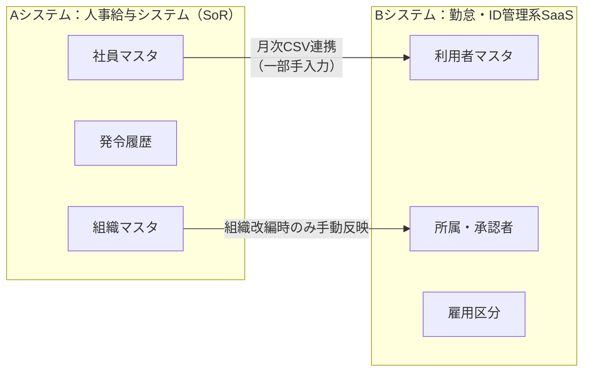
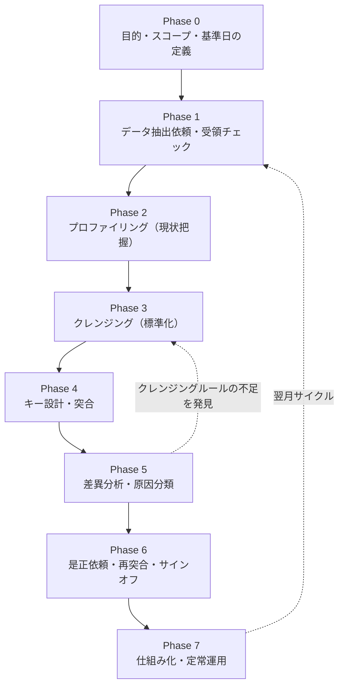
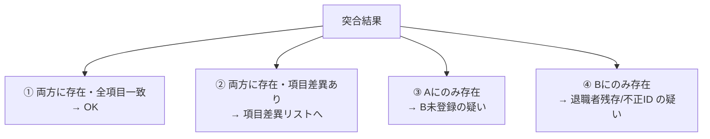
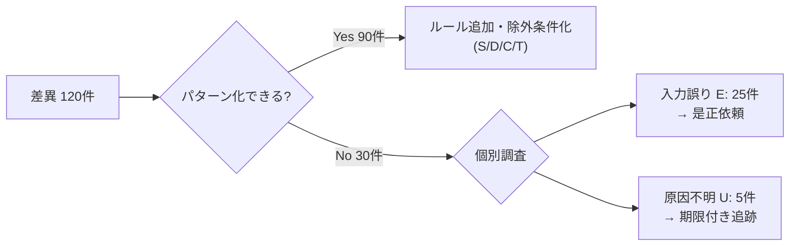

# 人事データ クレンジング・突合 実務ガイド
## ― プロの人事データアナリストの視点で読む「Aシステム × Bシステム」照合業務の全体像 ―

> **対象読者**: 人事部門のデータ担当者、ピープルアナリティクス担当者、人事システム運用担当者、そしてそれを支援するエンジニア
> **想定組織**: 従業員数 約1,000名（正社員・契約社員・嘱託・出向者を含む）の日本企業
> **本書の位置づけ**: シリーズ第1章。まず「実務の流れ」を理解し、第2章以降で Python（pandas）による仕組み化を段階的に実装する。

---

## 目次

0. [はじめに：なぜ「突合」が人事データ業務の要なのか](#0-はじめになぜ突合が人事データ業務の要なのか)
1. [用語の整理](#1-用語の整理)
2. [想定シナリオ：AシステムとBシステム](#2-想定シナリオaシステムとbシステム)
3. [実務の全体フロー（8フェーズ）](#3-実務の全体フロー8フェーズ)
4. [Phase 0：目的・スコープ・基準日の定義](#phase-0目的スコープ基準日の定義)
5. [Phase 1：データ抽出依頼と受領チェック](#phase-1データ抽出依頼と受領チェック)
6. [Phase 2：データプロファイリング（現状把握）](#phase-2データプロファイリング現状把握)
7. [Phase 3：クレンジング（標準化・正規化）](#phase-3クレンジング標準化正規化)
8. [Phase 4：キー設計と突合（マッチング）](#phase-4キー設計と突合マッチング)
9. [Phase 5：差異分析と原因分類](#phase-5差異分析と原因分類)
10. [Phase 6：是正依頼・再突合・サインオフ](#phase-6是正依頼再突合サインオフ)
11. [Phase 7：仕組み化と定常運用](#phase-7仕組み化と定常運用)
12. [ガバナンスと個人情報保護](#12-ガバナンスと個人情報保護)
13. [プロが必ず見る「落とし穴」チェックリスト](#13-プロが必ず見る落とし穴チェックリスト)
14. [本リポジトリでの実装ロードマップ](#14-本リポジトリでの実装ロードマップ)

---

## 0. はじめに：なぜ「突合」が人事データ業務の要なのか

1,000名規模の企業では、人事データは **単一のシステムに収まっていない** のが普通です。

- 人事給与システム（発令・異動・給与・社会保険）
- 勤怠管理システム（打刻・休暇・残業）
- タレントマネジメントシステム（評価・スキル・後継者）
- アカウント管理（Active Directory / IDaaS）
- 経理の人件費按分データ、健保組合・年金基金への届出データ ……

これらは **同じ「従業員」を、別々の目的・別々のタイミング・別々のルールで** 管理しています。結果として、次のような事故が日常的に起こります。

| よくある事故 | 原因 | 影響 |
| :--- | :--- | :--- |
| 退職者のアカウントが残り続ける | 人事の退職発令がID管理に連携されていない | 情報セキュリティ事故・監査指摘 |
| 異動者の勤怠承認者が旧上長のまま | 勤怠側の所属マスタ更新漏れ | 承認フロー不全・残業管理の形骸化 |
| 経営会議の「人員数」が部署ごとに違う | 集計元システムと基準日が人によって違う | 経営判断の誤り・人事部門の信頼失墜 |
| 休職者に通勤手当が支給され続ける | 休職発令が給与側に反映されていない | 過払い・返還請求・労務トラブル |

**突合（Reconciliation）** とは、こうした「システム間のズレ」を定期的に、網羅的に、証跡付きで洗い出す業務です。
そして突合の精度は、その前段の **クレンジング** の品質でほぼ決まります。

> 💡 **プロの視点**
> 突合の本当の目的は「差異をゼロにすること」ではありません。
> **「すべての差異に説明がつく状態」をつくり、その説明を第三者に示せること** が目的です。
> タイミング差のように "正しい差異" も存在するため、差異件数ではなく **"未説明差異" の件数** をKPIにします。

---

## 1. 用語の整理

実務では同じ言葉が人によって違う意味で使われがちです。本シリーズでは以下のように定義します。

| 用語 | 定義 | 例 |
| :--- | :--- | :--- |
| **クレンジング (Cleansing)** | 個々のデータセット内の表記ゆれ・欠損・型不整合を、定義したルールで標準化すること | 「ｴｲｷﾞｮｳ部」→「営業部」、`2024/4/1`→`2024-04-01` |
| **名寄せ (Identity Resolution)** | 「同一人物」を特定し、レコードを紐づけること | 社員番号が無い側を氏名＋生年月日で特定 |
| **突合 (Reconciliation / Matching)** | 2つ以上のデータセットをキーで結合し、存在差・項目差を検出すること | Aにいて Bにいない人の抽出 |
| **突合せ (Cross-check)** | 突合で検出した差異を、原票・発令書・本人確認などで裏取りし、どちらが正しいかを確定すること | 「異動発令書を確認し、Aが正しいと判定」 |
| **SoR (System of Record)** | その項目について「正」とみなすシステム（マスタ） | 所属＝人事給与システム、打刻＝勤怠システム |
| **基準日 (As-of Date)** | データをどの時点の状態で比較するかの日付 | 2026-10-31 23:59 時点 |
| **コントロールトータル** | ファイル受け渡し時に件数・合計値で欠落や改ざんを検知する手法 | 「総件数 1,043件、基本給合計 312,450,000円」 |

> ここでは「突合」を **機械的な照合**、「突合せ」を **人による裏取り・判定** と区別しています。
> 実務の工数の大半は、実は後者の「突合せ」にかかります。だからこそ前者を自動化する価値があります。

---

## 2. 想定シナリオ：AシステムとBシステム

本シリーズでは、以下の現実的な構成を前提にします。



| 観点 | Aシステム（人事給与） | Bシステム（勤怠・ID管理） |
| :--- | :--- | :--- |
| 役割 | 人事情報の **正（SoR）** | 日々の業務で利用 |
| 主キー | 社員番号（6桁、先頭ゼロあり 例 `001234`） | ユーザーID（`E1234` 形式）＋社員番号（任意項目） |
| 氏名 | 漢字姓・名を別項目、旧字体あり | 「姓 名」を1項目、全角/半角スペース混在 |
| 所属 | 組織コード（8桁）＋正式名称 | 部署名テキストのみ（略称・旧名称混在） |
| 雇用区分 | コード値（01:正社員, 02:契約, 03:嘱託, 09:出向受入…） | 日本語ラベル（「正社員」「契約社員」…） |
| 在籍状態 | 在籍／休職／退職 ＋ 発令日 | 有効／無効 フラグのみ |
| 日付形式 | `YYYYMMDD`（数値） | `YYYY/M/D`（文字列）、和暦が混ざる過去データあり |
| 文字コード | Shift_JIS (CP932) | UTF-8 (BOM付き) |
| 対象範囲 | 役員・出向者・休職者を含む全員 | 勤怠対象者のみ（役員・出向者は対象外） |

> 💡 **プロの視点**
> 突合の前に必ず確認するのが「**そもそも両システムの母集団は同じか？**」です。
> 上の例では B に役員・出向者がいないのは **仕様** であり、差異ではありません。
> これを最初に定義しないと、毎月「役員30名がBにいません」という無意味なアラートが出続けます。

### 1,000名規模での想定ボリューム感

| 項目 | 目安 |
| :--- | :--- |
| A 総レコード（退職者含む直近1年） | 約 1,100 件 |
| B 総レコード（無効ユーザー含む） | 約 1,150 件 |
| 月間の入社・退職・異動・休職発令 | 合計 40〜80 件 |
| 初回突合での差異件数（経験則） | 全体の 5〜15%（50〜150件） |
| 定常運用（仕組み化後）での未説明差異 | 0〜5 件／月 が目標 |

初回は差異が大量に出るのが普通です。**初回は「棚卸し」、2回目以降が「運用」** と割り切ることが重要です。

---

## 3. 実務の全体フロー（8フェーズ）



| Phase | 主なアウトプット | 担当（典型） | 初回工数目安 | 仕組み化後 |
| :--- | :--- | :--- | :--- | :--- |
| 0 定義 | 突合仕様書（目的・母集団・基準日・比較項目・SoR） | アナリスト＋人事企画 | 2〜3日 | 変更時のみ |
| 1 入手 | 抽出依頼書、受領記録、コントロールトータル | アナリスト＋システム管理者 | 1日 | 自動 |
| 2 把握 | プロファイリングレポート | アナリスト | 1〜2日 | 自動 |
| 3 標準化 | クレンジングルール表、変換ログ | アナリスト（＋エンジニア） | 2〜3日 | 自動 |
| 4 突合 | 突合結果（存在差・項目差） | 自動化対象 | 1日 | 自動（数秒） |
| 5 分析 | 差異リスト（原因分類・判定付き） | アナリスト＋各担当 | 3〜5日 | 0.5日 |
| 6 是正 | 修正依頼・再突合結果・承認記録 | 各システム担当 | 1〜2週 | 1〜2日 |
| 7 運用 | 手順書・ルール台帳・テスト・監査証跡 | アナリスト＋エンジニア | 継続 | 継続 |

以降、各フェーズを「**何をするか／なぜそうするか／プロはどこを見るか**」の順で解説します。

---

## Phase 0：目的・スコープ・基準日の定義

### 何をするか
突合を始める前に、以下の6点を **文書（突合仕様書）** にして関係者と合意します。

1. **目的**：何のための突合か（例：退職者アカウントの残存防止／人員数レポートの一致／監査対応）
2. **母集団**：比較対象とする従業員の範囲（雇用区分・在籍状態・会社コード）
3. **基準日**：いつ時点の状態を比べるか
4. **比較項目**：どの項目を比べるか（全項目ではない）
5. **SoR**：項目ごとにどちらのシステムを「正」とするか
6. **許容差**：どの程度のズレまでは差異としないか（例：発令日の翌営業日反映まではOK）

### 突合仕様書のテンプレート（例）

| 比較項目 | A項目名 | B項目名 | SoR | 比較方法 | 許容差・例外 |
| :--- | :--- | :--- | :--- | :--- | :--- |
| 存在（在籍） | 在籍区分 | 有効フラグ | A | 在籍/休職→有効、退職→無効 で一致すること | 退職日当日はB有効でも可 |
| 氏名 | 姓＋名 | 氏名 | A | 正規化後の完全一致 | 旧字体↔新字体は同一扱い |
| 所属 | 組織コード | 部署名 | A | 組織マスタ経由でコード変換し一致 | 組織改編月は翌月まで猶予 |
| 雇用区分 | 雇用区分コード | 雇用区分 | A | コード変換表で一致 | 出向受入はB対象外 |
| 入社日 | 入社年月日 | 利用開始日 | A | 完全一致 | Bは入社日前の事前登録あり（−7日まで可） |
| メールアドレス | ― | メール | B | 参考情報（比較しない） | ― |

### なぜそうするか
- 目的が曖昧だと「とりあえず全項目比較」になり、**ノイズの差異が数千件** 出て誰も見なくなります。
- **基準日** を決めないと、Aは月末締め・Bは今朝時点、といった **タイミング差** が全部差異として出ます。
- **SoR** を決めないと、差異が出た時に「どっちを直すか」で毎回議論になります。

### プロはここを見る
- ✅ 基準日の **時刻** まで決めているか（「10/31」ではなく「10/31 業務終了時点＝11/1 0:00 抽出」）
- ✅ **未来日付の発令**（11/1付け異動を10/25に入力済み）をどう扱うか決めているか
- ✅ 「退職日」の定義が両システムで同じか（**最終在籍日** なのか **退職日翌日＝資格喪失日** なのか）
- ✅ 兼務・出向・休職・育休など **例外的な在籍形態** の扱いを明記したか

---

## Phase 1：データ抽出依頼と受領チェック

### 何をするか
各システムの管理者に、**抽出条件を明文化して** データを依頼し、受け取ったら **中身を見る前に** 形式面の受領チェックを行います。

#### 抽出依頼書に書くこと
- 抽出基準日・抽出日時
- 抽出条件（例：在籍者＋直近13か月の退職者、全雇用区分、全会社コード）
- 出力項目と並び順（項目定義書を添付）
- ファイル形式（CSV、文字コード、区切り文字、ヘッダー有無、囲み文字）
- **コントロールトータル**（総件数、在籍区分別件数）の併記依頼
- 受け渡し方法（暗号化ZIP＋パスワード別送、または権限付き共有フォルダ）

#### 受領チェック（Python例）

```python
import hashlib
from pathlib import Path

import pandas as pd


def receive_check(path: Path, encoding: str, expected_rows: int) -> dict:
    """受領ファイルの形式チェック。中身の正しさではなく「欠けずに届いたか」を確認する。"""
    sha256 = hashlib.sha256(path.read_bytes()).hexdigest()

    # 社員番号の先頭ゼロ消失を防ぐため、受領時点では全列を文字列で読む
    df = pd.read_csv(path, encoding=encoding, dtype=str, keep_default_na=False)

    result = {
        "file": path.name,
        "sha256": sha256,            # 証跡：後から「同じファイルか」を証明できる
        "rows": len(df),
        "expected_rows": expected_rows,
        "row_count_ok": len(df) == expected_rows,
        "columns": list(df.columns),
    }
    return result
```

### なぜそうするか
- 受け取ったファイルが **途中で切れている**、**別の基準日のもの**、**Excelで一度開いて保存し直され先頭ゼロが消えている** ── 実務では珍しくありません。
- 後工程で「件数が合わない」と気づいてからでは、原因切り分けに丸1日かかります。

### プロはここを見る
- ✅ **全列を文字列（`dtype=str`）で読む**。数値変換はクレンジング工程で明示的に行う
- ✅ 元ファイルは **読み取り専用の `data/raw/` に保存し、絶対に上書きしない**（不変性）
- ✅ ファイルのハッシュ値・受領日時・受領者を記録（監査証跡）
- ✅ 文字コードの誤認識（`�` や `繧` のような文字化け）が無いか先頭・末尾を目視

---

## Phase 2：データプロファイリング（現状把握）

### 何をするか
クレンジングルールを決める前に、**データが実際にどうなっているか** を項目ごとに統計的に把握します。
「思い込みでルールを作らない」ためのフェーズです。

| 観点 | 確認内容 | 典型的な発見 |
| :--- | :--- | :--- |
| 件数 | 総件数、キーのユニーク数 | 社員番号の重複（再雇用・二重登録） |
| 欠損 | 項目ごとの空欄率 | Bの社員番号が15%空欄 |
| 値の分布 | カテゴリ項目の値一覧と件数 | 「営業部」「営業部 」「営業本部」「ｴｲｷﾞｮｳﾌﾞ」が混在 |
| 形式 | 桁数・パターン（正規表現） | 社員番号 5桁と6桁が混在＝先頭ゼロ消失 |
| 範囲 | 日付・数値の最小／最大 | 入社日 `1900-01-01`（ダミー値）、生年月日が未来 |
| 整合性 | 項目間の論理関係 | 退職日 < 入社日、在籍なのに退職日あり |

#### プロファイリング（Python例）

```python
def profile(df: pd.DataFrame) -> pd.DataFrame:
    """項目ごとの基本プロファイルを1表にまとめる。"""
    rows = []
    for col in df.columns:
        s = df[col]
        blank = s.str.strip().eq("") | s.isna()
        rows.append({
            "column": col,
            "blank_rate": round(blank.mean(), 3),
            "unique": s.nunique(dropna=True),
            "top_values": s.value_counts().head(5).to_dict(),
            "len_min": s.str.len().min(),
            "len_max": s.str.len().max(),
        })
    return pd.DataFrame(rows)
```

### プロはここを見る
- ✅ **「ユニーク数 = 件数」になるはずの項目**（社員番号）が本当にそうなっているか
- ✅ カテゴリ値の一覧を **全件** 見る（上位だけ見て、1件だけの表記ゆれを見逃さない）
- ✅ ダミー値（`9999-12-31`, `1900-01-01`, `0`, `-`, `なし`, `N/A`）の存在
- ✅ プロファイル結果を保存し、**前月と比較** する（急に欠損率が上がったら上流の仕様変更を疑う）

---

## Phase 3：クレンジング（標準化・正規化）

### 何をするか
プロファイリングで見つけた問題に対し、**ルールとして明文化した変換** を適用します。
日本の人事データには特有の論点が多いため、カテゴリ別に整理します。

### 3-1. クレンジングルールの分類

| 分類 | ルール例 | 実装のポイント |
| :--- | :--- | :--- |
| **文字種の正規化** | 全角英数→半角、半角カナ→全角カナ | `unicodedata.normalize("NFKC", s)` が基本 |
| **空白の正規化** | 前後空白除去、全角スペース→半角、連続空白→1つ | 氏名の姓名区切りは **残す** |
| **キーの正規化** | 社員番号を6桁ゼロ埋め、プレフィックス除去（`E001234`→`001234`） | `str.zfill(6)` |
| **日付の正規化** | `YYYYMMDD`, `YYYY/M/D`, 和暦 → ISO形式 `YYYY-MM-DD` | 変換不能は **NaT＋エラーログ**、推測しない |
| **コード⇔名称変換** | 雇用区分「正社員」→`01`、部署名→組織コード | **変換表（マッピングテーブル）をCSVで外出し** |
| **異体字の正規化** | 髙→高、﨑→崎、齋/齊→斎、邉/邊→辺 | 突合用の **比較キー列** にのみ適用（表示用の原文は残す） |
| **ダミー値の除去** | `9999-12-31`, `1900-01-01` → 空 | 「無期限」の意味がある場合は別フラグ化 |
| **論理チェック** | 退職日 ≥ 入社日、生年月日から算出した年齢が15〜80 | 直さずに **フラグを立てる**（修正は Phase 6 で） |

### 3-2. 鉄則：「原文を残し、比較用の列を作る」

```python
import unicodedata

# 異体字マップは台帳（CSV）で管理し、追加履歴を残す
ITAIJI_MAP = str.maketrans({"髙": "高", "﨑": "崎", "齋": "斎", "齊": "斎", "邉": "辺", "邊": "辺"})


def normalize_name(name: str) -> str:
    """突合キー用の氏名正規化。表示には使わない。"""
    if not isinstance(name, str):
        return ""
    s = unicodedata.normalize("NFKC", name)   # 全角英数・半角カナを統一
    s = s.translate(ITAIJI_MAP)               # 異体字を代表字に寄せる
    s = s.replace("　", " ")              # 全角スペース→半角
    s = " ".join(s.split())                   # 連続空白→1つ、前後除去
    return s


df_a["name_raw"] = df_a["last_name"] + " " + df_a["first_name"]   # 原文
df_a["name_key"] = df_a["name_raw"].map(normalize_name)          # 比較用
```

### なぜそうするか
- 正規化は **情報を失う変換** です（「髙」と「高」の区別が消える）。原文を上書きすると、是正依頼時に「元の値が何だったか」を示せなくなります。
- ルールをコードに直書きせず **台帳（CSV/YAML）に外出し** することで、人事担当者がルール追加をレビューでき、属人化を防げます。

### プロはここを見る
- ✅ すべての変換に **「変換前 → 変換後 → 適用ルールID」** のログが残るか
- ✅ **推測で埋めない**。欠損や変換不能はフラグを立てて人に回す（「たぶん営業部」は禁止）
- ✅ クレンジングは **冪等**（2回かけても結果が同じ）か
- ✅ 変換表に存在しない新しい値（新設部署など）が来たら **エラーとして止まる** 設計か

---

## Phase 4：キー設計と突合（マッチング）

### 4-1. キー設計：何で「同一人物」とみなすか

突合の成否はキー設計で決まります。プロは **複数のキーを優先順位付きで段階的に** 使います。

| 優先 | マッチングキー | 信頼度 | 用途 |
| :--- | :--- | :--- | :--- |
| 1 | 社員番号（正規化後） | ◎ 確定 | 基本はこれで突合 |
| 2 | メールアドレス（小文字化） | ○ 高 | Bの社員番号欠損レコードの救済 |
| 3 | 正規化氏名 ＋ 生年月日 | △ 中 | 1・2で紐づかない残りの救済 |
| 4 | 正規化氏名 ＋ 所属 | ▲ 低 | **候補提示のみ**。自動確定させない |

> ⚠️ **氏名だけでの突合は禁止**。1,000名規模でも同姓同名は普通に存在します（「佐藤 翔」「鈴木 健太」など）。
> 優先度3以下で紐づいたものは **「推定一致」として人が確認する** フローに回します。

### 4-2. 突合の基本形：完全外部結合 ＋ 存在区分

```python
merged = pd.merge(
    df_a, df_b,
    on="emp_id_key",
    how="outer",               # 両方の「片側にしかいない人」を拾うため必ず外部結合
    suffixes=("_a", "_b"),
    indicator=True,            # left_only / right_only / both を自動付与
    validate="one_to_one",     # 1:1 でなければ例外 → 重複キーを見逃さない
)
```

`validate="one_to_one"` で例外が出たら、**重複キーの解消が先** です（Phase 3 に戻る）。

### 4-3. 突合結果の4分類



| 区分 | 典型的な原因 | リスク | 優先度 |
| :--- | :--- | :--- | :--- |
| ① 完全一致 | ― | ― | ― |
| ② 項目差異 | 異動の反映漏れ、氏名変更（結婚等）未反映 | 承認フロー不全、誤集計 | 中 |
| ③ Aのみ | 入社直後の未登録、Bの対象外（役員等） | 業務に支障 | 中 |
| ④ **Bのみ** | **退職者アカウントの残存**、テスト用・共用ID | **情報漏えい・監査指摘** | **高** |

> 💡 **プロの視点**
> 最優先で見るのは **④ Bのみ**。「人事上は存在しないのに、システムにログインできる人」はセキュリティ上最大のリスクです。

### 4-4. 項目レベルの差異検出（縦持ち変換）

項目差異は **「1行＝1差異」の縦持ち形式** にすると、集計・フィルタ・是正依頼が圧倒的に楽になります。

```python
COMPARE_COLS = ["name_key", "org_code", "emp_type_code", "hire_date"]

both = merged[merged["_merge"] == "both"]
diffs = []
for col in COMPARE_COLS:
    a, b = both[f"{col}_a"], both[f"{col}_b"]
    mismatch = ~((a == b) | (a.isna() & b.isna()))
    for _, r in both[mismatch].iterrows():
        diffs.append({
            "emp_id": r["emp_id_key"],
            "item": col,
            "value_a": r[f"{col}_a"],
            "value_b": r[f"{col}_b"],
        })
diff_df = pd.DataFrame(diffs)
```

出力イメージ：

| emp_id | item | value_a | value_b | cause（Phase 5で付与） | judgment |
| :--- | :--- | :--- | :--- | :--- | :--- |
| 001234 | org_code | 31020100 | 31010100 | 異動反映漏れ | Bを修正 |
| 001877 | name_key | 田中 花子 | 山田 花子 | 婚姻による改姓・B未反映 | Bを修正 |
| 002015 | hire_date | 2026-10-01 | 2026-09-24 | 事前登録（許容範囲内） | 差異なし扱い |

---

## Phase 5：差異分析と原因分類

### 何をするか
検出した差異の **一件一件に原因と判定を付ける** フェーズです。ここが人事データアナリストの腕の見せ所です。

### 5-1. 差異の原因分類（標準コード）

| コード | 原因分類 | 説明 | 対応 |
| :--- | :--- | :--- | :--- |
| **T** | タイミング差 | 発令日と反映日のズレ、基準日の違い | 許容範囲内なら **説明済み差異** としてクローズ |
| **S** | 仕様差（スコープ差） | 片方のシステムの対象外（役員・出向者等） | 突合仕様の除外条件に追加し、次回から出ないように |
| **D** | 定義差 | 退職日の定義、所属の粒度（課まで/部まで）が違う | 変換ルールを追加（Phase 3へ） |
| **E** | 入力誤り | 手入力ミス、更新漏れ | **SoRでない側を是正**（Phase 6へ） |
| **C** | クレンジング不足 | 表記ゆれが残っていた | クレンジングルール追加（Phase 3へ） |
| **U** | 原因不明 | 調査中 | 期限を切って追跡。**このコードの件数が最重要KPI** |

### 5-2. 分析の進め方（プロの順番）

1. **件数の多い順にパターンで潰す**：「組織改編で旧組織コードのまま」が80件あれば、1件ずつではなく1つの原因として処理
2. **リスクの高い順に個別対応**：「Bのみ」の有効アカウント、給与に影響する項目
3. **ルールで再発防止できるものはルール化**：S・D・C は次回から自動で出なくする
4. **残った E と U だけを人が追う**



### プロはここを見る
- ✅ 差異の **裏取り（突合せ）** には一次資料を使う：発令通知書、稟議、入社書類、本人申告
- ✅ 「Aが正しいはず」と決めつけない。**SoRが間違っていることもある**（その場合はA側の是正が必要）
- ✅ 判定には **判定者・判定日・根拠資料** を必ず記録
- ✅ タイミング差でクローズしたものは、**翌月の突合で解消されているか** を必ず追跡

---

## Phase 6：是正依頼・再突合・サインオフ

### 何をするか
1. **是正依頼**：システム担当ごとに差異リストを切り出して依頼（依頼先・期限・修正内容を明記）
2. **再突合**：是正後に同じ手順で突合を再実行し、差異が解消したことを確認
3. **サインオフ**：人事責任者が「未説明差異ゼロ（または許容件数以下）」を確認し承認

### 是正依頼リストの必須項目

| 項目 | 内容 |
| :--- | :--- |
| 差異ID | 一意な追跡番号（例：`REC-202610-0042`） |
| 対象者 | 社員番号・氏名（**最小限の個人情報のみ**） |
| 対象システム・項目 | B / 所属 |
| 現在値 → あるべき値 | 31010100 → 31020100 |
| 根拠 | 2026-10-01付 異動発令（発令番号 HR-2026-0873） |
| 依頼先・期限 | 勤怠システム担当・2026-11-07 |
| ステータス | 依頼中 / 修正済 / 再突合OK / クローズ |

### プロはここを見る
- ✅ **アナリスト自身がシステムを直接修正しない**（職務分掌）。依頼と確認の役割を分ける
- ✅ 再突合で **新しい差異が増えていないか**（修正作業によるデグレ）
- ✅ サインオフの記録（誰が・いつ・何件の残差異を承認したか）を保管

---

## Phase 7：仕組み化と定常運用

初回の棚卸しで得た知見を **「ルール」と「コード」に変換** し、毎月の運用を数十分で回せる状態にします。

### 7-1. 仕組み化の5原則

| 原則 | 内容 | 実装イメージ |
| :--- | :--- | :--- |
| **① ルールの外出し** | クレンジング・変換・除外条件をコードから分離 | `config/mapping_*.csv`, `config/rules.yaml` |
| **② 不変の原本** | 受領データは上書きせず、処理結果は別に出力 | `data/raw/`（読み取り専用）→ `data/processed/` |
| **③ 冪等なパイプライン** | 何度流しても同じ結果 | 関数は入力DataFrameを変更しない |
| **④ 証跡の自動生成** | 変換ログ・差異リスト・実行日時・入力ハッシュを毎回保存 | `output/YYYYMM/` に一式出力 |
| **⑤ テストで守る** | 既知の差異パターンをテストデータ化 | `pytest` で「髙橋＝高橋」等を回帰テスト |

### 7-2. 月次運用カレンダー（例）

| 営業日 | 作業 | 所要時間（仕組み化後） |
| :--- | :--- | :--- |
| 第1営業日 | A・Bデータ抽出（自動 or 依頼） | 自動 |
| 第1営業日 | パイプライン実行（受領チェック→突合→レポート） | 数分 |
| 第2営業日 | 差異レビュー・原因分類 | 2〜3時間 |
| 第3〜5営業日 | 是正依頼・修正 | 各担当 |
| 第6営業日 | 再突合・サインオフ | 30分 |
| 随時 | ルール台帳の更新・テスト追加 | 都度 |

### 7-3. モニタリングすべきKPI

| KPI | 定義 | 目標 |
| :--- | :--- | :--- |
| 未説明差異件数 | 原因コード U の件数 | 0件 |
| 自動マッチ率 | 優先度1・2のキーで確定した割合 | 99%以上 |
| 是正リードタイム | 差異検出から修正完了までの日数 | 5営業日以内 |
| 退職者アカウント残存日数 | 退職日からB無効化までの日数 | 0〜1日 |
| 差異の再発率 | 前月と同じ原因の差異が再発した割合 | 減少傾向 |

---

## 12. ガバナンスと個人情報保護

人事データは **最も機微な個人情報** の一つです。仕組み作りの段階から以下を組み込みます。

| 観点 | 実務上の対応 |
| :--- | :--- |
| **データ最小化** | 突合に不要な項目（給与額、住所、マイナンバー、健康情報、評価）は **抽出依頼の段階で除外** |
| **マイナンバー** | 突合キーに使わない・受け取らない（番号法による利用制限） |
| **要配慮個人情報** | 休職理由・病歴等は扱わない。在籍区分「休職」のみで足りる |
| **アクセス制御** | 作業フォルダは担当者限定。共有はリンク共有ではなく権限付与 |
| **保管期限** | 原本・中間ファイルの保管期限と廃棄手順を定める |
| **リポジトリ管理** | **実データは絶対に Git にコミットしない**。`.gitignore` で `data/raw/` 等を除外し、開発・テストは **合成データ（ダミーデータ）** で行う |
| **ログ** | ログに氏名等を出しすぎない（社員番号のみ等） |

> 💡 **プロの視点**
> 本リポジトリのサンプルデータはすべて **架空の合成データ** です。実データで検証する場合は、社内の閉じた環境で、情報システム部門・個人情報保護責任者の承認を得てから行ってください。

---

## 13. プロが必ず見る「落とし穴」チェックリスト

### データ受領時
- [ ] Excelで開いて保存し直されていないか（**先頭ゼロ消失**、日付の自動変換、`1-2` が `1月2日` に）
- [ ] 文字コードは想定通りか（CP932 / UTF-8 / UTF-8 BOM）
- [ ] 機種依存文字（①、㈱、髙、﨑）が文字化けしていないか
- [ ] 件数はコントロールトータルと一致するか
- [ ] 抽出基準日は両システムで揃っているか

### クレンジング時
- [ ] 原文の列を残し、比較用の列を別に作っているか
- [ ] 推測で値を埋めていないか
- [ ] 変換表に無い値が来たときに **止まる** か
- [ ] ダミー日付（`1900-01-01`, `9999-12-31`）を処理しているか
- [ ] 和暦（`R6.4.1`, `H31.4.30`）と元号の切り替わり（平成→令和）を扱えるか

### 突合時
- [ ] 外部結合（outer join）で **両側の片寄り** を拾っているか
- [ ] キーの1:1を検証しているか（`validate="one_to_one"`）
- [ ] 氏名だけで自動確定していないか
- [ ] **再雇用者**（同一人物に社員番号が2つ）、**旧姓使用者**、**兼務者**（1人に所属2つ）を考慮したか
- [ ] **出向者**（籍は自社、勤務は他社）、**休職・育休者** の扱いを仕様通りにしているか

### 報告時
- [ ] 差異「件数」ではなく「未説明差異件数」で報告しているか
- [ ] 判定根拠と判定者が記録されているか
- [ ] 前月比較（新規発生・継続・解消）を示しているか
- [ ] 報告資料に不要な個人情報が含まれていないか

---

## 14. 本リポジトリでの実装ロードマップ

本書（第1章）で整理した実務フローを、以降の章で段階的に Python 実装していきます。

| 章 | テーマ | 対応Phase | 主な成果物（予定） |
| :--- | :--- | :--- | :--- |
| **第1章** | **実務の全体フロー（本書）** | 全体 | `docs/01_hr_data_reconciliation_workflow.md` |
| 第2章 | 合成データ生成：A・B 2システム分のリアルな"汚い"データを作る | 1 | `tools/generate_ab_sample_data.py` |
| 第3章 | 受領チェックとプロファイリング | 1・2 | `src/recon/intake.py`, `src/recon/profiling.py` |
| 第4章 | 日本の人事データ向けクレンジングエンジン | 3 | `src/recon/normalize.py`, `config/mapping_*.csv` |
| 第5章 | 段階的キーマッチングと差異検出 | 4 | `src/recon/matcher.py` |
| 第6章 | 差異分類・是正依頼リスト・レポート出力 | 5・6 | `src/recon/report.py`（Excel出力） |
| 第7章 | テスト・証跡・定常運用（CLI / Streamlit 画面統合） | 7 | `tests/test_recon_*.py`, `app.py` 拡張 |

想定ディレクトリ構成（拡張後）:

```text
├── config/                       # ルール台帳（人がレビューする設定）
│   ├── recon_spec.yaml           # 突合仕様（母集団・基準日・比較項目・SoR・許容差）
│   ├── mapping_emp_type.csv      # 雇用区分 コード⇔名称
│   ├── mapping_org.csv           # 部署名（旧名称・略称含む）→ 組織コード
│   └── itaiji.csv                # 異体字 → 代表字
├── data/
│   ├── raw/                      # 受領原本（不変・Git管理外）
│   │   ├── system_a/
│   │   └── system_b/
│   └── processed/                # クレンジング後データ
├── output/YYYYMM/                # 突合結果・差異リスト・変換ログ・実行証跡
├── src/recon/                    # 突合エンジン
└── tests/                        # 既知パターンの回帰テスト
```

---

### まとめ：プロの人事データアナリストの心得

1. **突合の前に「定義」を合意する** ── 母集団・基準日・SoR・許容差
2. **原本は触らない、変換は記録する** ── 不変性と証跡
3. **推測で埋めない、フラグを立てて人に回す** ── 誤った自動補正は差異より危険
4. **キーは段階的に、氏名だけで確定しない** ── 同姓同名・改姓・異体字
5. **差異ゼロではなく「未説明差異ゼロ」を目指す** ── 説明責任こそが成果物
6. **一度直した差異は、ルールにして二度と出さない** ── 仕組み化の本質

> 次章では、この流れを実際に体験するために、**AシステムとBシステムの「リアルに汚い」合成データ** を Python で生成します。
