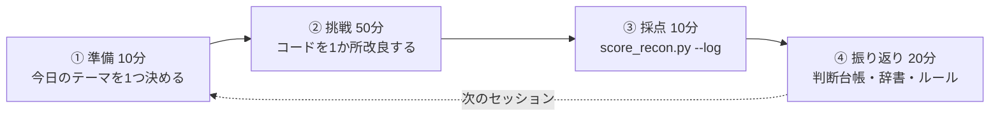

# トレーニングの進め方 ― 実践ガイド

> [第0章 トレーニングプログラム](00_hr_data_analyst_training_program.md) の「何を学ぶか」を、**毎日・毎週、具体的に何をするか** に落とした手引きです。
> このリポジトリには、練習用の合成データ生成器と自己採点ツールが入っています。これを使って「解く → 採点する → 振り返る」を繰り返します。

---

## 目次

1. [最初の30分：動かしてみる](#1-最初の30分動かしてみる)
2. [トレーニングの基本ループ（1セッション90分）](#2-トレーニングの基本ループ1セッション90分)
3. [練習データの突合仕様書（問題文）](#3-練習データの突合仕様書問題文)
4. [採点結果の読み方と次の一手](#4-採点結果の読み方と次の一手)
5. [難易度とseedの使い分け](#5-難易度とseedの使い分け)
6. [判断台帳の書き方](#6-判断台帳の書き方)
7. [Stage別の具体メニュー](#7-stage別の具体メニュー)
8. [最初の1週間のスケジュール](#8-最初の1週間のスケジュール)
9. [つまずいたとき](#9-つまずいたとき)
10. [上達の目安](#10-上達の目安)

---

## 1. 最初の30分：動かしてみる

```bash
# 1) 依存パッケージを入れる
pip install -r requirements.txt

# 2) 練習データを作る（難易度1、乱数の種42）
python tools/generate_ab_sample_data.py --level 1 --seed 42

# 3) スターターコードで突合する（わざと素朴に書いてある）
python learning/starter_recon.py

# 4) 採点する（--log で learning/score_log.csv に記録）
python tools/score_recon.py --log
```

最初の採点結果は、だいたい次のようになります。**不合格で正常です。** ここが出発点です。

```text
■ 名寄せ（同一人物の判定）
  正しく結合できた組   : 947 / 1030  (再現率 91.9%)
  誤統合（最重要）     : 0 件
■ 差異の検出
  検出できた差異       : 9 / 11  (再現率 81.8%)
  ノイズ（報告不要の差異）: 127 件
■ ノイズの推定原因
  - Bのみと報告したが、Aに結合すべき相手がいる（母集団の絞りすぎ・キーの不一致）: 78 件
  - 仕様上の対象外（役員・出向者）: 25 件
  - 氏名の空白ゆれ: 9 件 ……
 判定: ❌ 不合格
```

> 📱 スマホでの練習と、Excel / Googleスプレッドシートでの練習は [第3章](03_mobile_training.md) を参照してください（`--xlsx` で練習用ブックを作れます）。

生成されるファイル：

| 場所 | 中身 | 見てよいか |
|---|---|---|
| `data/ab/system_a_employees.csv` | Aシステム（人事給与）社員データ。CP932 | ✅ |
| `data/ab/system_a_org_master.csv` | Aシステム 組織マスタ（旧名称の履歴あり） | ✅ |
| `data/ab/system_b_users.csv` | Bシステム（勤怠・ID管理）ユーザーデータ。UTF-8（BOM付き） | ✅ |
| `data/ab/control_totals.json` | 抽出依頼書の控え（件数） | ✅ |
| `data/answer_key/` | **正解表** | ❌ 合格するまで開かない |

> ⚠️ `data/ab/` と `data/answer_key/` は Git の管理外です（`.gitignore` 済み）。何度でも作り直せます。

---

## 2. トレーニングの基本ループ（1セッション90分）



### ① 準備（10分）
- `learning/weekly_log.md` の「来週やること」と、前回の採点結果を見る
- **今日のテーマを1つだけ** 決める。例：「氏名の空白ゆれを吸収する」「休職者を母集団に入れる」
- 採点結果の **一番件数の多いノイズ／見逃し** から選ぶと、改善が数字に表れやすい

### ② 挑戦（50分）
- `learning/starter_recon.py`（または自分で作った突合コード）を **1か所だけ** 改良する
- 改良の前に、**なぜそれが差異（またはノイズ）になるのか** を受領データで確かめる

```python
# 例：Bの氏名にどんな空白が混ざっているか、実データで確かめてから直す
b["氏名"][b["氏名"].str.contains(r"\s{2,}|　|\s$", regex=True)].head(20)
```

### ③ 採点（10分）
```bash
python learning/starter_recon.py && python tools/score_recon.py --log
```
- 数字がどう動いたかを見る。**ノイズが減ったのに見逃しが増えた** 場合は、直しすぎ（本物の差異まで吸収した）を疑う

### ④ 振り返り（20分）
- 迷った判断を `learning/decision_ledger.csv` に1行書く（[第6節](#6-判断台帳の書き方)）
- 新しく知った制度・列の意味を `learning/data_dictionary.md` に追記
- 週の最後のセッションでは `learning/weekly_log.md` を書く

### 守るルール

| ルール | 理由 |
|---|---|
| **正解表（`data/answer_key/`）は開かない** | 答えを知った瞬間に、練習が「答え合わせ」ではなく「暗記」になる |
| **`--reveal` は週1回まで** | 個別の答えが表示される。まず種類別の集計だけで原因を推理する |
| **特定の社員番号・ユーザーIDを `if` 文で直さない** | seedを変えると通用しない。実務の翌月データにも通用しない |
| **1セッション1テーマ** | 一度に複数直すと、どの変更が効いたか分からなくなる |
| **原本（`data/ab/`）を書き換えない** | 実務の鉄則。直すのは読み込んだ後のDataFrameだけ |

---

## 3. 練習データの突合仕様書（問題文）

実務では Phase 0（[第1章](01_hr_data_reconciliation_workflow.md#phase-0目的スコープ基準日の定義)）で関係者と合意する内容です。練習では、以下が **合意済みの仕様** です。

### 3-1. 前提

| 項目 | 内容 |
|---|---|
| 目的 | Bシステムのアカウントが人事の実態と一致しているかを確認する |
| 基準日 | **2026-10-31** |
| 正とするシステム | **A（人事給与）** |

### 3-2. Aシステムの列

| 列 | 値 |
|---|---|
| 在籍区分 | `1`=在籍 `2`=休職 `3`=退職 |
| 雇用区分 | `00`=役員 `01`=正社員 `02`=契約社員 `03`=嘱託 `04`=パート `09`=出向受入 |
| 出向区分 | `0`=なし `1`=他社へ出向中 |
| 日付 | `YYYYMMDD`（退職年月日は在籍者は空欄） |

### 3-3. 突合の対象（母集団）

- **Aの突合対象**：在籍区分が `1` または `2`、かつ 雇用区分が `00` 以外、かつ 出向区分が `0`
  - 役員・出向中の社員は **Bの対象外（仕様）**。差異として報告しない
- **Aの退職者（在籍区分 `3`）**：Bにアカウントが **残っていれば** 突合し、比較する。Bにアカウントがなければ報告しない
- **Bの全ユーザー**：すべて突合対象

### 3-4. 同一人物の判定（名寄せ）

- キーの優先順位：①社員番号（6桁にそろえる）→ ②メールアドレス（大文字・小文字を区別しない）
- **氏名だけで同一人物と確定してはいけない**（同姓同名の別人がいる）
- 1人の人物が **再雇用** されると、Aには新旧2つの社員番号がある。Bのアカウントは **現在の雇用（在籍中のレコード）** に結合する

### 3-5. 比較する項目と判定ルール

| item | 比較内容 | 差異としない条件 |
|---|---|---|
| `name` | 姓＋名 ↔ 氏名 | 空白の有無・全角半角・異体字（髙↔高 など）の違いだけなら一致 |
| `org` | 組織コード ↔ 部署名 | 略称・旧名称・表記ゆれでも、同じ組織コードを指していれば一致 |
| `emp_type` | 雇用区分 ↔ 雇用形態 | ラベルの表記ゆれだけなら一致 |
| `hire_date` | 入社年月日 ↔ 利用開始日 | 利用開始日が入社日の **0〜7日前**（事前登録）なら一致 |
| `status` | 在籍区分 ↔ 有効 | 在籍・休職 → `1`、退職 → `0` なら一致 |
| `emp_no` | 社員番号 ↔ B社員番号 | 先頭ゼロの有無だけなら一致。**空欄・別の番号は差異** |
| `a_only` | Aの突合対象で、Bに結合相手がいない | — |
| `b_only` | Bのユーザーで、Aのどのレコードにも結合しない | — |

メールアドレスは名寄せのキーにだけ使い、比較はしません。

### 3-6. 提出形式

`learning/output/` に2つのCSVを出力します（UTF-8）。

**matches.csv**（同一人物と判定した組）
```csv
a_emp_id,b_user_id
000123,E10033
```

**diffs.csv**（報告すべき差異。1行＝1差異）
```csv
a_emp_id,b_user_id,item,cause
000123,E10033,org,E
001150,,a_only,T
,T0001,b_only,E
```

- `a_only` の行は `b_user_id` を空欄に、`b_only` の行は `a_emp_id` を空欄にする
- `a_emp_id` は **6桁のAの社員番号** で書く
- `cause`（原因コード）は任意。Stage 6 から付ける（`T` タイミング差／`E` 入力誤り）

---

## 4. 採点結果の読み方と次の一手

### 4-1. 指標

| 指標 | 意味 | 優先度 | 合格基準 |
|---|---|---|---|
| **誤統合** | 別人（または別の雇用レコード）を同一人物と判定した件数 | **最優先** | **0件** |
| 差異の再現率 | 報告すべき差異のうち、検出できた割合 | 高 | 90%以上 |
| ノイズ | 報告しなくてよいのに報告した差異の件数 | 中 | 5件以下 |
| 名寄せの再現率 | 結合すべき組のうち、結合できた割合 | 中 | （参考） |
| 原因コードの正答 | `cause` 列の正答数 | Stage 6〜 | 90%以上 |

> 💡 誤統合は、実務では **他人の給与を払う・他人の情報を見せる** 事故につながります。見逃しは次回直せますが、誤統合は気づかれないまま広がります。だから最優先です。

### 4-2. ノイズの推定原因 → 何を直すか

| 採点結果の表示 | 何が起きているか | 直す場所 | Stage |
|---|---|---|---|
| 仕様上の対象外（役員・出向者） | 母集団の絞り込みが仕様と違う | Aの突合対象の条件 | 1 |
| Bのみと報告したが、Aに結合すべき相手がいる | 退職者・休職者を母集団から外しすぎ、またはキーがそろっていない | 母集団／キーの正規化 | 1・4 |
| Aのみと報告したが、Bに結合すべき相手がいる | 社員番号が欠けている・ゼロが落ちている相手を結合できていない | 名寄せのキー | 4・5 |
| 氏名の空白ゆれ／異体字 | 比較の前に氏名を正規化していない | 氏名の比較キー | 4 |
| 社員番号の先頭ゼロ消失 | 6桁へのゼロ埋めをしていない | 社員番号の正規化 | 4 |
| 部署名の略称・表記ゆれ／旧部署名 | 部署名 → 組織コードの変換表がない | 変換表（`config/` にCSVで） | 4 |
| 雇用形態ラベルのゆれ | ラベル → コードの変換表がない | 変換表 | 4 |
| 日付形式のゆれ（和暦・ISO） | 日付を1つの形式で解釈している | 日付の解析関数 | 4 |
| 許容範囲内の事前登録 | 7日以内の許容差を実装していない | 入社日の比較ルール | 5 |
| 原因不明 | 上のどれでもない | 突合ロジック全体を見直す | — |

### 4-3. 見逃しの種類 → 何を足すか

| 採点結果の表示 | 足りないもの |
|---|---|
| 退職者アカウントの残存 | 退職者とBアカウントの突合、`status` の比較 |
| 休職者アカウントの誤った無効化 | 休職者を母集団に入れる、`status` の比較 |
| 社員番号の空欄 | メールでの名寄せ、`emp_no` の比較 |
| 再雇用者の旧社員番号 | 「退職レコードに有効なアカウントが結合した」ときの再確認ロジック |
| 同姓同名の別人 | 氏名ではなくメールで名寄せし、`emp_no` の空欄を報告 |
| 登用の反映漏れ／利用開始日の入力誤り | `emp_type`・`hire_date` の比較 |
| 月中入社者の未登録 | `a_only` の検出 |

---

## 5. 難易度とseedの使い分け

| level | 汚れの種類 | 報告すべき差異 | 目安のStage |
|---|---|---|---|
| 1 | 9種類（表記ゆれ・基本的な入力誤り） | 約10件 | Stage 4 |
| 2 | 20種類（異体字・旧部署名・社員番号空欄・再雇用・同姓同名など） | 約30件 | Stage 5〜6 |
| 3 | 20種類・件数増 | 約50件 | Stage 6〜7 |

**進め方**
1. `--level 1 --seed 42` で合格を目指す
2. 合格したら **コードを変えずに** seedを変えて（`--seed 1`, `--seed 2026` …）再採点する
3. 別のseedでも合格したら、次のlevelへ
4. 不合格なら、そのseedで直す。**直したら元のseedでも合格するか** を必ず確認する

> 💡 「同じコードで、別のseedでも合格する」ことが、**翌月の実データでも通用する** ことの練習上の証明です。特定のseedだけで合格するコードは、実務では役に立ちません。

---

## 6. 判断台帳の書き方

### いつ書くか
- 3分以上迷ったとき
- 採点結果が自分の予想と違ったとき
- 「実務なら誰かに確認するはずだ」と思ったとき

### 悪い例と良い例

| | situation | chosen | reason | who_to_confirm_in_real_work |
|---|---|---|---|---|
| ❌ | 部署名が違った | 直した | 合わせるため | — |
| ✅ | Bの部署名「営業第一部」がAの組織マスタの現行名称にない | 組織マスタの履歴（有効終了日 20260331）から、組織コード 31010100 の旧名称と判断して一致扱い | 組織コードが同じなら同じ組織。名称は2026-04-01の組織改編で変わっただけ | Bシステムの管理者（組織改編の反映予定を確認）。旧名称のまま残っていること自体は是正依頼の対象 |

**良い記録の条件**
- 状況が **データの具体的な値** で書かれている
- **選ばなかった選択肢** が書かれている（`options` 列）
- 理由が「制度・仕様」に基づいている
- 実務なら **誰に確認するか** が書かれている

---

## 7. Stage別の具体メニュー

[第0章](00_hr_data_analyst_training_program.md) の各Stageで、この教材をどう使うかの対応表です。

| Stage | この教材でやること | 目標の採点結果 |
|---|---|---|
| **0** 学習基盤 | 第1節の4コマンドを実行。判断台帳の例（J0001）を読み、自分の1行目を書く | 採点ログに1行目が記録される |
| **1** 意味を知る | 第3節の仕様書を読み、スターターの母集団の条件（`a_target`）を直す。休職・役員・出向・退職の扱いをデータ辞書に書く | 「仕様上の対象外」ノイズ **0件** |
| **2** 定義して数える | `data/ab/` で、基準日時点の在籍人数を部署別・雇用区分別に数える。`control_totals.json` と件数を照合する | 数字すべてに「時点・母集団・定義」の注記 |
| **3** 汚れを知る | **正解表を見ずに**、受領データを観察して「汚れのカタログ」（種類・例・件数）を自分で作る。プロファイリングのコードを書く | カタログに10種類以上 |
| **4** そろえる | 氏名・社員番号・部署名・雇用形態・日付を正規化する。変換表を `config/` にCSVで作る | **level 1 合格** |
| **5** 突き合わせる | メールでの名寄せ、全項目の比較、許容差、再雇用・同姓同名への対応 | **level 2 合格**（誤統合0件） |
| **6** 説明する | `cause` 列を付ける。是正依頼リスト（Excel）と1枚報告を作る。Claudeに「未知の汚れ」を追加してもらう（下記） | 原因コード正答率 **90%以上** |
| **7** 仕組みにする | 突合コードを関数・テスト・CLIに整理。既存コード（`src/`）の欠陥を直す。生成器に **自作の汚れ** を1種類追加し、正解表とテストも書く | **level 3 合格を5つのseedで連続** |
| **8** 運用し証明する | 生成器に「翌月を進める」機能を自作し、3か月分の模擬運用を回す。ポートフォリオにまとめる | 3か月目の作業時間が1か月目の1/3以下 |

### Stage 6：「未知の汚れ」の入れ方

自分で仕込んだ汚れは、自分の想像の範囲を出ません。Stage 6 からは、他人に汚れを入れてもらいます。

Claudeへの頼み方の例：
> 「`src/training/ab_generator.py` を、私に内容を教えずに改造して、新しい汚れを3種類追加してください。正解表に記録されるようにし、何を追加したかは私に言わないでください。」

自分でできる「現実の事故」の再現：
- `system_b_users.csv` を **Excelで開いて上書き保存** する（先頭ゼロ、日付の自動変換が起きる）
- 文字コードを変えて保存し直す

> ⚠️ 生成器のソースコード（`src/training/ab_generator.py`）には汚れの種類がすべて書かれています。**level 3 に合格するまでは読まない** でください。Stage 7 で、改造のために初めて読みます。

---

## 8. 最初の1週間のスケジュール

1日90分 × 5日 ＋ 週末の振り返りの例です。

| 日 | テーマ | やること | 終わりの状態 |
|---|---|---|---|
| **Day 1** | 動かす | 第1節の4コマンド。採点結果をそのまま `weekly_log.md` に貼る | 不合格の結果が手元にある |
| **Day 2** | 受領チェック | 3つのCSVを `dtype=str` で読み、件数を `control_totals.json` と照合。文字コードを変えて読むと何が起きるか試す | 件数一致を確認。文字化けを一度見た |
| **Day 3** | 問題文を読む | 第3節の仕様書を読み、分からない用語をデータ辞書に書き出す。在籍区分・雇用区分・出向区分ごとの件数を数える | データ辞書に10語以上 |
| **Day 4** | 母集団を直す | スターターの `a_target` を仕様どおりに直す（1テーマ）→ 採点 | 「仕様上の対象外」ノイズが0件 |
| **Day 5** | 退職者を扱う | 退職者のBアカウントを突合対象に入れ、`status` を比較する → 採点 | 「退職者アカウントの残存」の見逃しが0件 |
| **週末** | 振り返り | `weekly_log.md` を書く。判断台帳を見直し、来週のテーマ（例：氏名の正規化）を決める | 来週やることが3つ以内で決まっている |

---

## 9. つまずいたとき

| 症状 | 原因と対処 |
|---|---|
| `UnicodeDecodeError` | Aは `encoding="cp932"`、Bは `encoding="utf-8-sig"` で読む |
| 社員番号が `881` のように5桁未満になる | `dtype=str` を付けずに読んでいる。または Bの先頭ゼロ消失（`zfill(6)` でそろえる） |
| `MergeError: Merge keys are not unique` | `validate="one_to_one"` が重複キーを見つけた。**どのキーが重複しているか** を先に調べる（再雇用・メール共有） |
| 「誤統合」が出た | 氏名で結合していないか。メールで結合したとき、Aに候補が2件（再雇用の新旧）ある場合をどう扱ったか |
| ノイズを減らしたら見逃しが増えた | 正規化しすぎ（例：部署名を全部同じとみなした）。差異を吸収するのは **仕様で許された違いだけ** |
| 正解表を見てしまった | seedを変えて新しい問題を作る。見てしまったことも判断台帳に書く（正直さも訓練） |
| 何から直せばよいか分からない | ノイズの推定原因の **一番件数が多いもの** から1つだけ直す |

---

## 10. 上達の目安

スターターコード（無改造）の採点結果（seed=42）：

| level | 名寄せの再現率 | 誤統合 | 差異の再現率 | ノイズ |
|---|---|---|---|---|
| 1 | 91.9% | 0件 | 81.8%（9/11） | 127件 |
| 2 | 89.6% | 0件 | 41.9%（13/31） | 203件 |
| 3 | 88.1% | 0件 | 35.2%（19/54） | 270件 |

> スターターの誤統合が0件なのは、社員番号の完全一致でしか結合していないからです。**名寄せを賢くしようとした瞬間に、誤統合のリスクが生まれます。** Stage 5 で、それを0件のまま再現率を上げるのが山場です。

到達の目安：

| 時期 | 状態 |
|---|---|
| 第1週の終わり | level 1 のノイズが半分以下 |
| Stage 4 の終わり（第13週） | level 1 合格、別のseedでも合格 |
| Stage 5 の終わり（第16週） | level 2 合格、誤統合0件 |
| Stage 7 の終わり（第22週） | level 3 を5つのseedで連続合格、pytestで自分の正規化ルールを回帰テスト |

---

> **次の一歩**：第1節の4つのコマンドを実行し、最初の採点結果を `learning/weekly_log.md` に貼ってください。
